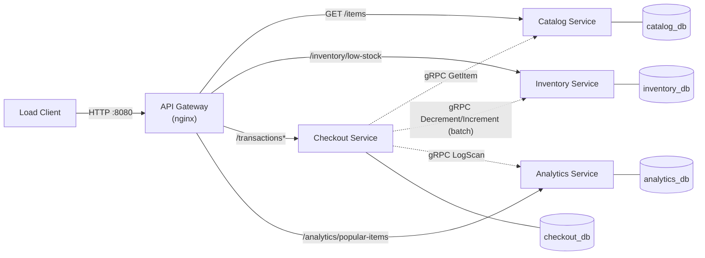
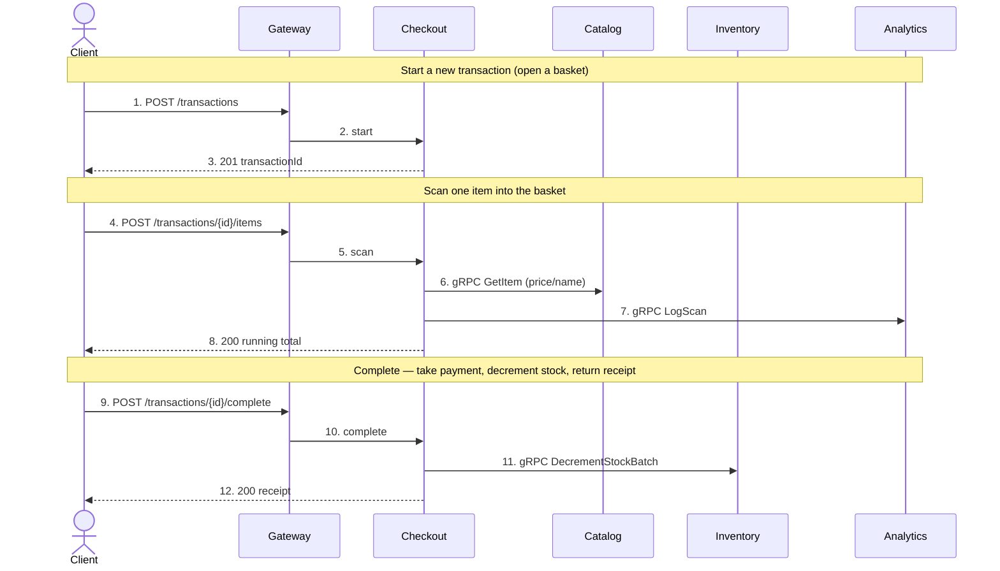

# CS6510 — Self-Checkout: Microservices Architecture

An independently-deployable **microservices** implementation of the self-checkout
backend system. Each service owns its **own database**; services communicate via
**gRPC**; and the one API request that must update two data stores — completing a
transaction — is coordinated by an **orchestrated saga**. The system is reached
through an nginx API gateway on `http://localhost:8080`.

## Tech stack

Java 21 · Spring Boot 4.1 · Maven multi-module reactor · gRPC (protobuf contracts in
the shared `proto` module) · PostgreSQL 16 (one per service) · nginx gateway · Docker
Compose. See [`load-test-results/`](load-test-results) for the raw reports.
## Architecture



Solid arrows are external REST through the gateway; dashed arrows are internal
gRPC calls between services. Every service has its own Postgres database and
nothing is shared — there is no shared database and no shared persistence library.

| Service | Owns (database) | REST (via gateway) | gRPC it serves | Talks to |
|---|---|---|---|---|
| **Catalog** | `catalog_db` — `catalog_items` | `GET /items` | `GetItem` | — |
| **Inventory** | `inventory_db` — `inventory_stock` | `GET /inventory/low-stock` | `DecrementStock(Batch)`, `IncrementStock(Batch)` | — |
| **Checkout** | `checkout_db` — `transactions`, `transaction_line_items` | `POST /transactions`, `/items`, `/complete`, `GET /transactions/{id}` | — | Catalog, Inventory, Analytics |
| **Analytics** | `analytics_db` — `scan_events`, `popular_items_snapshot` | `GET /analytics/popular-items` | `LogScan` | — |

### Request flow — a complete checkout, end to end



Checkout is the only caller of other services. The scan's `LogScan` is best-effort
(Analytics being down never fails a scan); the complete is a saga — if Checkout's
local commit fails after the decrements, it returns the units to Inventory, so the
two databases stay consistent without a shared transaction.

## Running it

Build the service jars, then build images and start everything:

```bash
mvn -DskipTests package
docker compose up -d --build --force-recreate
```

Run the load client from original course repo:

```bash
cd ../load-client && ./build.sh
./run.sh --baseUrl=http://localhost:8080 --stations=10  --duration=60    # default
./run.sh --baseUrl=http://localhost:8080 --stations=100 --duration=120   # stress
```

For a clean, reseeded run (stock back to 10 000 per SKU):

```bash
docker compose down && docker compose up -d --build
```

### Stopping the stack

```bash
docker compose down        # safe stop: removes containers + network, keeps nothing running
# docker compose down -v    # also wipe the databases (full clean slate)
```

## Performance 

Measured on the same hardware with the same load client. Reports are in
[`load-test-results/`](load-test-results). 

| Scenario | Metric | service-based | **microservices** |
|---|---|---:|---:|
| Default — 10 stations / 60 s | Throughput | 420.9 tx/s | **213.4 tx/s** |
| | SCAN p99 | 4.5 ms | **12.4 ms** |
| | COMPLETE p99 | 14.3 ms | **45.7 ms** |
| Stress — 100 stations / 120 s | Throughput | 479.3 tx/s | **315.5 tx/s** |
| | SCAN p99 | 60.8 ms | **69.4 ms** |
| | COMPLETE p99 | 66.7 ms | **518.4 ms** |

Potential Suspected Causes for Degraded Performance:

1. **Network hops replace in-process calls.** In the service-based version, a scan
   read the catalog price and logged the scan with local method calls against one
   shared database. Here, each scan makes a gRPC round trip to Catalog **and** one
   to Analytics, each with protobuf serialization and a network traversal. SCAN is
   the dominant operation (~10× more scans than completes), so these two extra hops
   per scan drive most of the throughput loss.

2. **One business transaction now spans two databases.** Completing a basket must
   update `checkout_db` **and** `inventory_db`. With a single shared database that
   was one local transaction; now it is a remote batched decrement against Inventory
   plus a separate local commit in Checkout, coordinated by the saga — more commits,
   more connections, and no shared buffer cache.

3. **Correctness requires serialization on hot rows.** To guarantee stock never
   oversells, Inventory decrements under a `SELECT … FOR UPDATE` row lock. Under 100
   stations the Zipf-weighted sampler concentrates demand on a few SKUs (SKU-000001
   especially), so many concurrent completions **queue on the same locked rows**.
   That contention is exactly why COMPLETE p99 jumps to ~518 ms under stress while
   staying ~46 ms at low load — the tail is lock-wait, the honest price of
   distributed, never-oversell stock management.

4. **Extra gateway + process overhead.** Every request still crosses the nginx
   gateway (as in the service-based week), and there are now four JVMs and four
   Postgres instances competing for the same host resources instead of three JVMs on
   one database.

