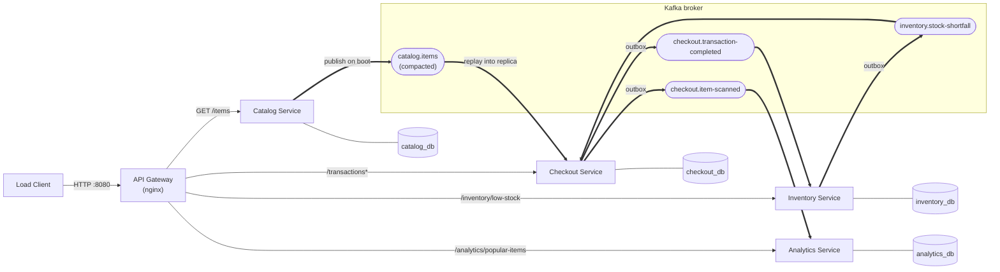
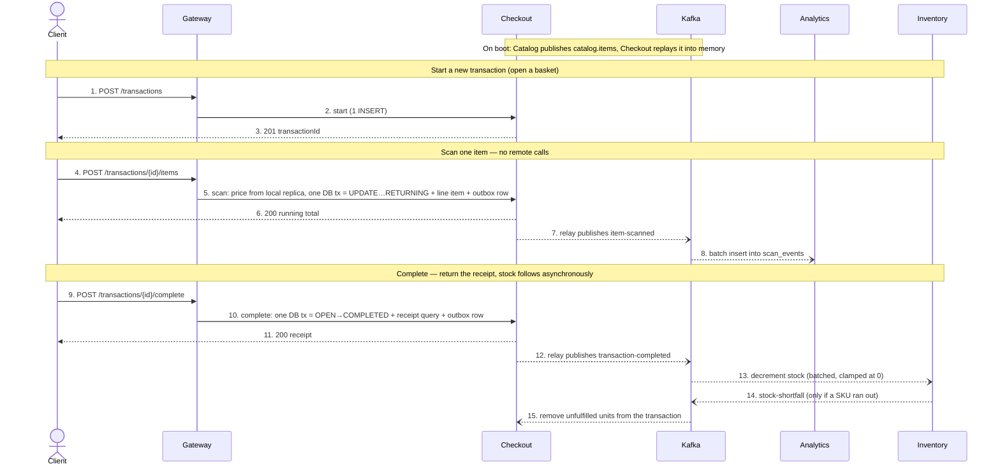

# CS6510 — Self-Checkout: Event-Driven Microservices (Kafka)


## Tech stack

Java 21 · Spring Boot 4.1 · Spring for Apache Kafka · Apache Kafka 3.9 · PostgreSQL 16 (one per service) ·
 · nginx gateway · Docker 

## Architecture



Thin arrows are external REST through the gateway; thick arrows are Kafka events.
Every service reads and writes only its own database. A service that needs another
service's data either keeps its own copy built from events (checkout's catalog
replica) or reacts to events (inventory, analytics).

| Service | Owns (database) | REST (via gateway) | Publishes | Subscribes (consumer group) |
|---|---|---|---|---|
| **Catalog** | `catalog_db` — `catalog_items` | `GET /items` | `catalog.items` | — |
| **Checkout** | `checkout_db` — `transactions`, `transaction_line_items`, `outbox`, `processed_events` | `POST /transactions`, `/items`, `/complete`, `GET /transactions/{id}` | `checkout.item-scanned`, `checkout.transaction-completed` | `catalog.items` (no group — replayed on boot), `inventory.stock-shortfall` (`checkout-service`) |
| **Inventory** | `inventory_db` — `inventory_stock`, `processed_transactions`, `outbox` | `GET /inventory/low-stock` | `inventory.stock-shortfall` | `checkout.transaction-completed` (`inventory-service`) |
| **Analytics** | `analytics_db` — `scan_events`, `popular_items_snapshot` | `GET /analytics/popular-items` | — | `checkout.item-scanned` (`analytics-service`) |

### Topics

| Topic | Key | Partitions | Producer → consumer | Purpose |
|---|---|---:|---|---|
| `catalog.items` | `sku` | 1, **compacted** | Catalog → Checkout | The full catalog as a replayable table (Kafka keeps only the latest message per SKU). Checkout reads it start-to-end on boot into an in-memory price/name map, so a scan never calls Catalog. |
| `checkout.item-scanned` | `transactionId` | 6 | Checkout → Analytics | One event per scanned unit. Feeds the popular-items hopping window. |
| `checkout.transaction-completed` | `transactionId` | 6 | Checkout → Inventory | One event per paid basket with per-SKU quantities. Inventory decrements stock. |
| `inventory.stock-shortfall` | `transactionId` | 6 | Inventory → Checkout | Units Inventory could not fulfil (stock hit 0). Checkout removes them from the stored transaction — the compensating step of the saga. |

Topics are declared in code (`events/KafkaTopicsConfig`) and broker auto-creation is
off, so partitions and compaction are always explicit.

### Message shapes

All events are JSON. Every event except the catalog snapshot carries a random
`eventId` so consumers can detect redeliveries. Samples captured from the running
system:

**`catalog.items`** — key `SKU-000001`
```json
{"sku": "SKU-000001", "name": "Item 1", "price": 0.85}
```

**`checkout.item-scanned`** — key `tx-aefc77e2-…`
```json
{
  "eventId": "cf5c44db-7ee6-4029-8cf7-3413ff5c1fb5",
  "transactionId": "tx-aefc77e2-eb8f-4eec-a92b-6acbd370a5aa",
  "sku": "SKU-000001",
  "name": "Item 1",
  "unitPrice": 0.85,
  "scannedAt": "2026-10-30T21:45:58.286584382"
}
```

**`checkout.transaction-completed`** — key `tx-aefc77e2-…`
```json
{
  "eventId": "e7103a8a-742f-48e5-a0c0-618b78d0351e",
  "transactionId": "tx-aefc77e2-eb8f-4eec-a92b-6acbd370a5aa",
  "lines": [
    {"sku": "SKU-000001", "quantity": 2},
    {"sku": "SKU-000002", "quantity": 1}
  ]
}
```

**`inventory.stock-shortfall`** — key `tx-…` (illustrative; produced only once a SKU runs out)
```json
{
  "eventId": "9b1c…",
  "transactionId": "tx-…",
  "lines": [{"sku": "SKU-000001", "unfulfilled": 1}]
}
```

### Tracing Through a Transaction



**Correctness Considerations:**

- **Transactional outbox.** Events are written to an `outbox` table in the same DB
  transaction as the business change, so they commit or roll back together. A relay
  publishes them to Kafka every 10 ms, then deletes them.
- **Idempotent consumers.** Delivery is at-least-once, so each consumer drops
  duplicates (`event_id`, `processed_transactions`, `processed_events`).
- **Choreographed saga.** Complete doesn't wait on Inventory. Inventory, the single
  writer of stock, clamps at 0 and reports shortfalls back to Checkout. Once topics
  drain, the stock invariant holds and stock is never negative.


## Performance

Measured on the same hardware with the same load client, stock reseeded to 10,000
per SKU before each run.

| Scenario | Metric | service-based | microservices (gRPC) | **event-driven (Kafka)** |
|---|---|--------------:|---------------------:|-------------------------:|
| Default — 10 stations / 60 s | Throughput |    420.9 tx/s |           213.4 tx/s |           **387.1 tx/s** |
| | Transactions completed |        25,263 |               12,813 |               **23,232** |
| | SCAN p99 |        4.5 ms |              12.4 ms |               **8.2 ms** |
| | COMPLETE p99 |       14.3 ms |              45.7 ms |               **8.8 ms** |
| Stress — 100 stations / 120 s | Throughput |    479.3 tx/s |           315.5 tx/s |           **644.8 tx/s** |
| | Transactions completed |        57,625 |               37,958 |               **77,458** |
| | SCAN p99 |       60.8 ms |              69.4 ms |              **36.9 ms** |
| | COMPLETE p99 |       66.7 ms |             518.4 ms |              **36.4 ms** |

All runs: 0 errors. Compared with the gRPC microservices, throughput is +81% at default
load and +104% under stress, and COMPLETE p99 under stress is 14× lower. Under stress
it is also the fastest of every week so far — 77,458 completed transactions, ahead of
the previous best of 76,001 (pipeline architecture with in-memory analytics).

Why it improved:

1. **No remote calls on the request path.** Scan made 2 blocking gRPC calls and
   complete made one per distinct SKU plus one. Now prices come from Checkout's in-memory catalog replica,
   receipt names are stored at scan time, and outgoing events are outbox rows.

2. **Investigated and removed hot-row lock queue.** Completions used to hold `SELECT … FOR UPDATE` locks for
   the whole basket, queueing on SKU-000001 (the 518 ms p99). Now one Inventory
   consumer applies up to 500 baskets per transaction, off the HTTP path.

3. **Fewer DB round trips.** START is one INSERT. SCAN and COMPLETE use one atomic
   `UPDATE … RETURNING` instead of re-reading the same row, which also fixes two
   latent races. Analytics batches its INSERTs.

4. **Runtime tuning.** Virtual threads, a 20-connection pool for Checkout,
   `reWriteBatchedInserts`, and a 50 ms consumer fetch wait.

## Running it

```bash
./start.sh    # build jars, fresh databases + Kafka topics, waits until healthy
```

Load client (from the course repo), then the invariant check once consumer lag is 0:

```bash
cd ../CS6510/CS6510-2026/load-client && ./build.sh
./run.sh --stations=10  --duration=60     # default
./run.sh --stations=100 --duration=120    # stress (./start.sh again first for fresh stock)

```

Run the `diff` from the repo root. Kafka UI: http://localhost:8090. Stop everything:
`docker compose down`.
